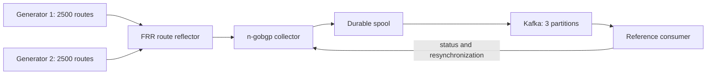

# R04 live capture recovery laboratory

Run this scenario on the authorized cloud Docker host (`157.173.116.3`) or a
disposable CI runner. Manual regression tests are not run on the workstation.
It uses an independent FRR route reflector, two raw iBGP generators, n-gobgp,
a Kafka broker with three partitions and the actual reference consumer binary.



## Run on the cloud host

From a saved checkout on the cloud host:

```sh
R04_OUTPUT_DIR=/var/tmp/ngobgp-r04-lab-run1 bash test/r04/lab.sh
```

The output directory must be empty. Choose a fresh directory for every run so
old phase/acknowledgement files cannot make a test pass. Optional
`R04_MODULE_CACHE` and `R04_BUILD_CACHE` paths reuse prepared Go dependencies;
otherwise the caches are inside the output directory. `R04_GO_IMAGE`,
`R04_FRR_IMAGE` and `R04_KAFKA_IMAGE` can override images for a deliberate
interoperability comparison; evidence records the actual image identities.

Preparation may download images and Go modules. The actual lab network is
Docker-internal, with IPv4 `10.231.84.0/24` and IPv6 `fd42:231:84::/64`.
No host ports, host network, Docker socket or privileged containers are exposed.
FRR receives NET_ADMIN, NET_RAW and SYS_ADMIN inside its own container because
the pinned daemon checks require them. It uses `bgp no-rib` and does not install
learned routes in the host. Existing containers and networks are preserved.

| Component | CPU cap | Memory cap |
| --- | --- | --- |
| Collector and reference consumer | 3 | 6 GiB |
| Kafka | 1 | 1 GiB |
| FRR | 0.5 | 512 MiB |
| Each generator | 0.25 | 128 MiB |

## Assertions

1. Establish three iBGP sessions with the FRR reflector.
2. Advertise 5,000 routes: each generator sends 1,250 IPv4 /32s and 1,250 IPv6
   /128s. They drain reflected updates and send KEEPALIVEs throughout the test.
3. Hold the event callback briefly while the native bounded ingress queue
   overflows. BGP processing continues; the out-of-band status must become
   invalid without requiring a Kafka loss marker.
4. Release the callback, request a fenced resynchronization and prove that the
   reference state and independent Adj-RIB-In inspection agree on every route
   and routing attribute. Observe records from multiple Kafka partitions.
5. Start the real reference consumer executable and verify its report against
   the same RIB digest.
6. Stop Kafka while BGP stays established. Withdraw 400 prefixes, announce 400
   replacement prefixes and change ORIGIN on 400 retained routes. The final
   route count remains 5,000, so count-only validation cannot pass this test.
7. Restart the same broker. The CLI detects loss/lag, requests recovery when
   appropriate and reconstructs the new generation. Both reference instances
   must converge to the current RIB digest. Peer uptime and flap counters must
   remain unchanged.

The initial callback hold is a test-only fault injector around the native event
source, not a production pause mechanism. Topic creation, broker lifecycle and
synthetic prefixes are limited to this laboratory. The reference consumer is
not a production database or a Kafka authentication configuration example.

## Evidence and cleanup

The script preserves `result.json`, collector/reference logs, FRR summary,
generator acknowledgements, broker logs and image metadata. It automatically
removes only its own containers and network, including on failure; evidence and
dependency caches remain. An interrupted process that cannot execute its trap
may require cleanup of resources bearing that run's `ngobgp-r04-` prefix.

`result.json` is written only after convergence, actual CLI validation and
session-continuity assertions pass. The same scenario is an obligatory CI job;
unit tests skip it unless `NGOBGP_R04_LAB=1` is explicitly supplied by the lab.
